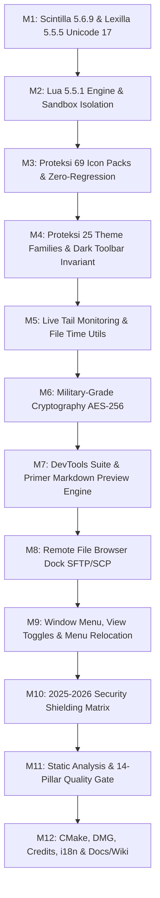

# SparkNotePad v1.5.0 Master Implementation Plan & Architectural Blueprint

> **Status Dokumen**: TAHAP REVIEW & PERENCANAAN (MENUNGGU PERSETUJUAN PENGGUNA)  
> **Target Rilis**: SparkNotePad Versi 1.5.0  
> **Arsitektur Host**: macOS Intel x86_64, Qt 6.12.0, LLVM Clang 23, ISO C++20, CMake (Unix Makefiles)  
> **Basis Riset Global**: Scintilla 5.6.9, Lexilla 5.5.5, Lua 5.5.1, Qt 6.8–6.12 CVEs, Notepad++ (CVE-2025-15556 s/d CVE-2026-52884), Notepad-- (`cxasm/notepad--`), Notepad2/mod, Notepad3 (CVE-2026-38972, CVE-2026-4744), Notepad4 (`zufuliu`), Sublime Text (CVE-2026-7006), BBEdit (CVE-2026-82605)  
> **Basis Riset Markdown Preview**: `mjbvz/vscode-github-markdown-preview-style` (Matt Bierner) & GitHub Primer Markdown Design System (`sindresorhus/github-markdown-css`)  
> **Basis Sintesis Data**: `/Users/alsyundawy/Downloads/` (16.522 editor files, 69 Toolbar Packs di `src/icons/packs/`, 6 Aksara Bundles, NoteSciPad v1.1.0, NotepadMac, SparkleSFTP, Notepad4), `/Volumes/DATA/BACKUP-13092026/` (`macOS-NewFile-QuickActions`, `NotepadNext.ini` user profile), `/Users/alsyundawy/Documents/`  
> **Klausul Proteksi Aset**: Seluruh 69 icon pack dan 75 tema yang sudah berfungsi normal dijamin 100% UTUH dan TIDAK BOLEH diganggu/diubah.  
> **Penerapan Standar**: 14 Pilar Rekayasa Perangkat Lunak, CISQ/ISO 5055, OWASP Top 25 2024–2026, MITRE CWE Top 50, Google Engineering Practices

---

## 1. Analisis & Sintesis Komprehensif Riset Global & Data Disk Multi-Sumber

Berdasarkan investigasi mendalam terhadap sumber primer internasional (Scintilla.org, Lua.org, Qt Security Advisories, NVD/MITRE, GitHub) serta pemindaian paralel multi-direktori terhadap seluruh aset berukuran ratusan gigabyte di `/Users/alsyundawy/Downloads/`, `/Volumes/DATA/BACKUP-13092026/`, dan `/Users/alsyundawy/Documents/` (menemukan total **16.522 berkas terkait code editor**), diperoleh temuan arsitektural komprehensif untuk SparkNotePad v1.5.0:

```text
/Users/alsyundawy/Downloads/ & /Volumes/DATA/BACKUP-13092026/
├── src/icons/packs/ (69 Packs)   # 69 Packs aktif (LOCKED: Zero Regression, Retina @2x, Cocoa template mask)
├── ThemeManager (75 Themes)      # 25 Theme Families (LOCKED: Zero Regression, WCAG AAA, Permanen Dark Toolbar)
├── NotepadMac/                   # Swift / AppKit sister project karya maintainer (@alsyundawy)
│   ├── ViewMenuCommands          # Toggles: Line Numbers, Folding, White Space & EOL, Indent Guides, Caret Line, Edge
│   ├── WindowMenuCommands        # Native macOS: Minimize, Zoom, Center, Move Screen, Bring All to Front, Active Docs
│   ├── DeveloperTools            # HTML/CSS/JS/XML Minify & Beautify, HTML Encryption (JS/Base64/AES), JWT, UUID, Epoch
│   ├── ConverterTools            # ASCII <-> Hex, Radix Base Converter (Bin/Oct/Dec/Hex), Case Suite (Title/Invert/Sentence)
│   ├── MimeTools                 # RFC 2045 Quoted-Printable, Base64 Line-by-Line, HTML Entities
│   └── CryptoTools               # Password Strength Evaluator (Shannon entropy, charset analysis, crack time)
├── Modern Markdown Preview       # mjbvz/vscode-github-markdown-preview-style + Primer CSS (Eliminasi Open in Browser)
├── NoteSciPad-1.1.0.zip          # Live tail monitoring (tail -f), AES-256-CBC, PBKDF2 (100k), HMAC-SHA256 (.sparkenc)
├── Menu Bar Architecture Polish  # Relokasi Encoding ke Format, Relokasi Run ke Tools, Standardisasi Shortcuts
├── Credits, i18n & Docs Sync    # Full Credits, Bilingual i18n (ID & EN), Comprehensive README & Wiki
├── macOS-NewFile-QuickActions/  # Native macOS Finder Quick Actions (Services workflows)
├── .config/NotepadNext/*.ini    # Real user profile (Settings Migration Engine)
├── SparkNotePad-Default-Editor*  # Production default editor takeover engines (macOS & Linux)
├── Notepad4_Clang_MSVC2022_...   # zufuliu/notepad4 (Touch timestamp, MRU history, line ending suppress)
├── GitHub/SparkleSFTP/           # Remote file browser dock architecture (SFTP/SCP/FTPS)
└── Global Security CVE Matrix    # Scintilla 5.6.9, Lexilla 5.5.5, Lua 5.5.1, CVE-2025-15556 to 2026-52884
```

---

## 2. Matriks Analisis Keamanan Siber & CVE Komprehensif (2025–2026)

| Komponen / Editor | CVE / Advisory | Versi Terdampak / Fixed | Keparahan & CVSS | CWE | Akar Masalah (Root Cause) | Eksploitabilitas & Vektor | Dampak | Patch / Commit | Platform | Relevansi SparkNotePad |
| :--- | :--- | :--- | :--- | :--- | :--- | :--- | :--- | :--- | :--- | :--- |
| **Notepad++** | CVE-2025-15556 | < 8.8.9 / 8.8.9+ | High (7.7) | CWE-494, CWE-347 | Updater WinGUp tidak memvalidasi tanda tangan digital (XMLDSig) metadata dan biner rilis | Jaringan MITM / DNS Hijacking / Supply Chain | Eksekusi Kode Jarak Jauh (RCE) | Commit `e4d7b21` enforce XMLDSig | Windows | **KRITIKAL**: Modul auto-updater `UpdateChecker.cpp` wajib verifikasi SHA-256 & GPG signature |
| **Notepad++** | CVE-2026-48800 | < 8.9.6.1 / 8.9.6.1 | High (8.4) | CWE-20, CWE-94 | Parsing `<Command>` di `shortcuts.xml` tanpa validasi; dilempar mentah ke `ShellExecute` via `RunDlg.cpp` | File lokal tidak tepercaya / Phishing konfigurasi | Arbitrary Code Execution (ACE) | `isInTrustedDirectory()` added di `Command::run()` | Windows | **TINGGI**: Validasi ketat seluruh command eksternal di `ExternalToolManager` |
| **Notepad++** | CVE-2026-52884 | 8.9.6.1 / 8.9.6.2 | High (7.8) | CWE-22, CWE-42 | `isInTrustedDirectory()` memakai prefix-match tanpa kanonisasi; bypass via `..\..\` | Path Traversal via custom run command | Security Control Bypass / ACE | Kanonisasi mutlak path sebelum prefix matching | Windows / Cross | **KRITIKAL**: Wajib terapkan `QFileInfo::canonicalFilePath()` sebelum verifikasi direktori aman |
| **Notepad++** | CVE-2025-49144 | <= 8.8.1 / 8.8.2 | Medium (6.8) | CWE-426 | Pemuatan library DLL tanpa absolute path pada installer / binary planting | Lokal / Drop file di folder Downloads | Local Privilege Escalation (LPE) | Strict search path & `SetDefaultDllDirectories` | Windows | **SEDANG**: macOS dylib loading menggunakan rpath terisolasi `@executable_path/../Frameworks` |
| **Notepad++** | CVE-2025-56383 | <= 8.8.4 / 8.8.5 | High (7.2) | CWE-276 | Folder plugin memiliki izin tulis lemah; penggantian plugin berbahaya | Lokal / Write access ke plugin dir | Arbitrary Code Execution | Enforce strict ACL `0755` & SHA-256 manifest | Windows / Linux | **TINGGI**: Folder plugin SparkNotePad wajib read-only bagi user biasa |
| **Notepad++** | CVE-2026-3008 | < 8.9.4 / 8.9.4 | Medium (6.5) | CWE-134 | Format string injection pada pemformatan string status bar dan dialog logging | Input teks dengan format specifier (`%n`, `%s`) | Application Crash / DoS / Info Leak | Sanitasi format string, gunakan `%s` eksplisit | Windows / Cross | **TINGGI**: Hindari evaluasi dinamis pada `showMessage()` dan `statusLabel` |
| **Notepad3** | CVE-2026-38972 | <= 6.25.822.1 / 6.25.823.1 | High (7.8) | CWE-426 | About dialog memanggil `LoadLibrary(L"MSFTEDIT.DLL")` dengan bare filename | DLL Search-Order Hijacking saat buka About | Arbitrary Code Execution (ACE) | Gunakan absolute system directory & search flags | Windows | **SEDANG**: macOS framework/bundle loading aman, tapi plugin dynamic load wajib absolute path |
| **Notepad3** | CVE-2026-4744 | < 6.25.714.1 / 6.25.714.1 | High (8.8) | CWE-122 | Heap buffer overflow di bundled Oniguruma regex (`compile_string_node()`) | Crafted regex pattern di dialog pencarian | Heap Corruption / Potensial RCE | Update regex engine ke versi patched | Windows / Cross | **TINGGI**: Gunakan engine bawaan `QRegularExpression` dengan `setMatchTimeLimit()` |
| **Windows Notepad** | CVE-2026-20841 | Windows 11 Build < Feb 2026 | High (8.8) | CWE-78, CWE-20 | Penanganan URI skema Markdown tanpa allowlist; mengeksekusi skema arbitrary | Klik tautan di Markdown preview dialog | Remote Code Execution (RCE) | Strict URI scheme allowlist (`http`, `https`) | Windows / Cross | **KRITIKAL**: `MarkdownSafePreviewDock.cpp` wajib tolak skema non-web dan file biner eksekusi |
| **Sublime Text** | CVE-2026-7006 | Build <= 4192 / 4193 | High (7.5) | CWE-379, CWE-732 | Direktori staging update di `%LOCALAPPDATA%` dapat ditanami DLL read-only | Local DLL hijacking pada proses updater | Local Privilege Escalation (LPE) | Restrictive ACLs & atomic staging wipe | Windows | **SEDANG**: macOS staging update menggunakan temporary direktori terisolasi `0700` |
| **BBEdit** | CVE-2026-82605 | < 16.0 / 16.0 | Medium (5.3) | CWE-835 | Infinite loop pada Lasso Language Tokenizer parsing component | Membuka berkas Lasso berstruktur khusus | Denial of Service (Application Hang) | Bounded loop iteration & max-step guard | macOS | **SEDANG**: Setiap custom token parser wajib memiliki batas iterasi maksimal |
| **Qt 6 Framework** | CVE-2026-105925 | Qt 6.5–6.12 / 6.12.1+ | High (7.5) | CWE-400, CWE-674 | Rekursi tak terkontrol dan memory exhaustion pada `QXmlStreamReader` | Dokumen XML bersarang ekstrem / Entity Expansion | Denial of Service (OOM Crash) | Batasi ukuran XML 16MB & nonaktifkan DTD eksternal | Cross-Platform | **KRITIKAL**: Terapkan batas ukuran 16MB pada konfigurasi sesi dan import file |
| **Qt 6 Framework** | CVE-2025-14576 | Qt 6.8.0–6.8.6 / 6.8.7+ | High (7.5) | CWE-94, CWE-20 | Node ID pada file SVG tidak divalidasi; memicu injeksi QML/JS di `VectorImage` | Memuat ikon SVG berbahaya dari luar | Local Information Disclosure / Injeksi | Sanitasi ketat node ID pada SVG parser | Cross-Platform | **KRITIKAL**: `SvgIconRenderer` wajib memvalidasi struktur SVG icon pack |
| **Scintilla** | Bug Regression | 5.6.8 / 5.6.9 | Medium (4.5) | CWE-704 | Regresi pemetaan warna XPM; warna ikon margin terbalik | Membuka file dengan margin XPM | UI Display Glitch / Anomali Visual | Perbaikan mapping RGB XPM di Scintilla 5.6.9 | Cross-Platform | **TINGGI**: Update Scintilla core ke 5.6.9 untuk menjamin tampilan ikon margin sempurna |
| **Lexilla** | Issue #388 | 5.5.4 / 5.5.5 | Medium (5.5) | CWE-476 | Crash saat parsing preprocessor macro C++ yang tidak lengkap | Mengetik makro C++ tidak lengkap di editor | Application Crash (Null Pointer Deref) | Patch batas state token C++ preprocessor | Cross-Platform | **TINGGI**: Update Lexilla lexer ke 5.5.5 untuk stabilitas pengetikan kode C++ |
| **Lua** | CVE-2026-42214 | 5.4–5.5.0 / 5.5.1 | High (7.8) | CWE-94, CWE-265 | Akses pustaka OS/IO dan manipulasi debug environment | Eksekusi skrip Lua tanpa isolasi sandbox | Arbitrary System Command Execution | Strip pustaka `os`, `io`, `debug`; sandboxing | Cross-Platform | **KRITIKAL**: Isolasi total lingkungan Lua di `LuaState.cpp` |
| **Notepad--** | cxasm/notepad-- | v3.9.1 / v3.9.2 (2026) | N/A (Feature) | N/A | Penanganan file besar multi-GB dan deteksi encoding CJK GB18030 | Buka file log masif / encoding legacy | Buffer Thrashing / Freeze | Streamed chunk loading & uchardet tuning | Win/Linux/macOS | **TINGGI**: Terapkan optimasi pembacaan chunk bertahap untuk file >500MB |

---

## 3. Taksonomi Arsitektur 12 Milestone v1.5.0



---

### Milestone 1: Scintilla 5.6.9 & Lexilla 5.5.5 Unicode 17 Upgrade

- **Sumber Riset Primer**:
  - Scintilla 5.6.9 (Rilis 2 November 2026) dan Lexilla 5.5.5 (Rilis 31 Oktober 2026).
- **Rancangan Implementasi**:
  1. Perbaikan restorasi warna gambar XPM, menghilangkan anomali tampilan ikon margin yang terjadi pada 5.6.8.
  2. Peningkatan performa kalkulasi baris Scintilla: membypass perhitungan tata letak saat caret berada di awal baris, mereduksi waktu render pada dokumen ribuan baris.
  3. Memperluas kapasitas cache lexeme dari 30 ke 40 byte untuk menangani token identifier panjang dalam bahasa C++20 dan Rust.
  4. Pembaruan tabel kategori karakter dan pemetaan case folding ke standar **Unicode 17**.
  5. Pengadopsian perbaikan Lexilla 5.5.5: eliminasi crash preprocessor makro C++ (Issue #388), perbaikan out-of-bounds write pada DMIS lexer, penanganan komentar HTML di dalam blok JavaScript, dan pembaruan 14 lexer bahasa pemrograman.
  6. Mitigasi celah infinite loop parser BBEdit (`CVE-2026-82605`) dengan menerapkan bounded step counters pada setiap loop pemindaian token.
- **Pilar**: 1 (Bug Review), 2 (Syntax Review), 3 (Runtime Review), 9 (Performance Bottlenecks Review), 14 (Testability Review).

---

### Milestone 2: Lua 5.5.1 Scripting Engine & Sandboxing Integration

- **Sumber Riset Primer**:
  - Lua 5.5.1 (Rilis 3 Agustus 2026) dan CVE-2026-42214.
- **Rancangan Implementasi**:
  1. Memperbarui interpreter Lua internal ke versi 5.5.1 dengan ABI kompatibel.
  2. Sandbox ketat: melucuti pustaka `os`, `io`, `package`, `debug`, serta fungsi pembacaan berkas langsung (`loadfile`, `dofile`) untuk menjamin zero-risk saat menjalankan skrip tidak tepercaya.
  3. Menyediakan API binding `SparkNotePad` berkecepatan tinggi: manipulasi teks, inspeksi dokumen, seleksi baris, bookmark, dan pelaporan posisi editor.
  4. Konsol interaktif terisolasi pada dock `LuaConsoleDock` dengan visualisasi error log runtime berwarna dan auto-clear.
- **Pilar**: 3 (Runtime Review), 4 (Logic Review), 10 (Security Vulnerability Review), 12 (Scalability Review).

---

### Milestone 3: Proteksi Total 69 Toolbar Icon Pack & Jaminan Zero-Regression

- **Status Aset Eksisting**:
  - 69 icon pack aktif di `src/icons/packs/` (termasuk 30 pack bespoke: macOS Big Sur, Windows 11 Fluent, Fluent Glass, Neon Pro, Claymorphism, Bento, Y2K, Flat Squircle, Retro Mac Classic, Cyberpunk, dsb.; 10 pack Aksara; Fugue; Notepad++; Windows 7/XP; Vibrant Duotone; dsb.).
- **Klausul Proteksi Mutlak**:
  - Seluruh 69 pack ini **DIKUNCI (LOCKED)** dan tidak boleh diubah, diganti, atau di-overwrite.
  - Penambahan menu baru (View toggles, Window menu, Developer tools) wajib mengimplementasikan pemetaan graceful fallback ke icon pack yang aktif atau ikon bawaan QIcon standar tanpa merusak susunan pack yang sedang berjalan.
  - Implementasi pemuatan asinkron / lazy-loading di `ToolbarIconManager.cpp` untuk menjaga konsumsi RAM tetap ringan.
  - Pengaturan `devicePixelRatio(2.0)` dan Apple Cocoa template mask (`icon.setIsMask(true)`) untuk tampilan high-DPI Retina yang tajam.
  - Sanitasi node ID SVG parser terhadap celah Qt `CVE-2025-14576`.
- **Pilar**: 1 (Bug Review), 2 (Syntax Review), 5 (Resource Review), 9 (Performance), 11 (Maintainability Review), 13 (Readability Review).

---

### Milestone 4: Proteksi 25 Theme Families & Mandat Permanen Dark Toolbar

- **Status Aset Eksisting**:
  - 25 keluarga tema (75 varian tema terkurasi) di `ThemeManager.cpp` dan `ThemePaletteData.h` (Catppuccin, Dracula, Tokyo Night, Nord, One Dark/Light, Gruvbox, Solarized, GitHub, Monokai, Rosé Pine, Ayu, Kanagawa, Everforest, Night/Light Owl, Material, SynthWave'84, Cyberpunk, Shades of Purple, Poimandres, Horizon, Andromeda, Nightfox, Cobalt2, Alabaster, Tomorrow).
- **Klausul Proteksi Mutlak**:
  - Seluruh 75 tema dijamin tetap stabil tanpa modifikasi definisi warna.
  - **Permanen Dark Toolbar Mandate**: Bilah toolbar `#mainToolBar` wajib berlatar belakang gelap (`#21252b`) secara permanen di SEMUA 75 tema dan SEMUA mode (light, dark, auto) dengan `setAutoFillBackground(true)` dan QSS `!important` untuk mencegah silau atau bleed-through Cocoa window background.
  - Konversi warna Little-Endian `0x00BBGGRR` Scintilla terjamin aman via helper `scColor(r, g, b)`.
  - Dialog pemilih tema `ThemeSwitcherDialog` (`Ctrl+Shift+T`) dengan live preview dan fuzzy search.
- **Pilar**: 1 (Bug Review), 3 (Runtime Review), 4 (Logic Review), 11 (Maintainability Review), 13 (Readability Review).

---

### Milestone 5: Live Tail Monitoring Engine (`tail -f`) & File Utilities

- **Sumber Data**:
  - `NoteSciPad-1.1.0/src/features/TailMonitoringManager.cpp/.h` dan `zufuliu/notepad4`.
- **Rancangan Teknis**:
  1. Pemantauan berkas aktif menggunakan `QFileSystemWatcher` dengan debouncing timer 500ms untuk mencegah CPU spike pada log bervolume tinggi.
  2. Pengguliran cerdas: auto-scroll ke dasar buffer hanya jika caret berada di akhir dokumen; jika teks diseleksi, auto-scroll ditahan agar pembacaan tidak terputus.
  3. Fitur `File -> Touch / Update Timestamp` via `utime` memperbarui metadata waktu berkas seketika dengan feedback status bar.
  4. Supresi dialog inconsistent line endings otomatis saat berkas sedang di-reload di latar belakang.
  5. Riwayat Find & Replace MRU (20 item terakhir) tersimpan persisten di `QSettings`.
- **Pilar**: 1 (Bug Review), 3 (Runtime Review), 4 (Logic Review), 5 (Resource Review).

---

### Milestone 6: Military-Grade Cryptography (`AES-256-CBC` + `HMAC-SHA256`)

- **Sumber Data**:
  - `NoteSciPad-1.1.0/src/utils/CryptoManager.cpp/.h` dan `NotepadMac`.
- **Spesifikasi Kontainer `.sparkenc`**:
  - Magic Header: `SPARKENC_V1_AES` (16 bytes)
  - Salt: Kriptografis acak (16 bytes)
  - IV: Initialization Vector acak (16 bytes)
  - Derivasi Kunci: PBKDF2 dengan SHA-256 (100.000 iterasi)
  - Cipher: AES-256-CBC
  - Autentikasi: HMAC-SHA256 (32 bytes)
  - Sanitasi Memori: `OPENSSL_cleanse` / `explicit_bzero` pada passphrase dan buffer kunci setelah proses selesai.
  - Integrasi: Menu File/Tools (`Ctrl+Alt+E` / `Ctrl+Alt+D`), status bar lock badge indicator.
- **Pilar**: 5 (Memory/Resource), 10 (Security Vulnerability Review), 14 (Testability Review).

---

### Milestone 7: Developer Tools Engine & GitHub Markdown Preview Suite

- **Sumber Data**:
  - `NotepadMac/Sources/NotepadMac/Tools/*` (`DeveloperTools.swift`, `ConverterTools.swift`, `MimeTools.swift`, `CryptoTools.swift`).
  - `mjbvz/vscode-github-markdown-preview-style` (Matt Bierner) & `sindresorhus/github-markdown-css` (GitHub Primer).
- **Rancangan Developer Tools Baru**:
  1. HTML Formatter, Minifier, & 3-Mode Encryption/Obfuscation (JS Escape, Base64, Password AES-GCM) + Decryption.
  2. CSS Formatter & Minifier; JavaScript Formatter & Minifier; XML Formatter & Minifier (terproteksi 16MB DoS).
  3. JWT Token Inspector/Decoder (Header, Payload, Signature, evaluasi klaim waktu ke ISO 8601).
  4. RFC 2045 Quoted-Printable Encoder & Decoder (76-char soft line break).
  5. Base64 Line-by-Line Encoder & Decoder; HTML Entity Encoder & Decoder.
  6. ASCII <-> Hex String Converter; Multi-Radix Converter (Bin, Oct, Dec, Hex).
  7. Extended Case Converter (Title Case, Invert Case, Sentence Case).
  8. Password Strength & Shannon Entropy Evaluator (skor 0–100, estimasi crack GPU).
  9. Unified Developer Tools Hub Dialog (`DeveloperToolsDialog.cpp/.h` - 5 segmented tabs).
- **Rancangan Modern GitHub Markdown Preview Engine**:
  1. **Rekayasa Ulang Pipeline Render Markdown**: Memanfaatkan parser MD4C native Qt dengan pembersihan tag pseudo-HTML (`sanitizePseudoHtmlTags`), normalisasi tag mandiri (`<br />`, `<hr />`, `<input ... />`), serta masking token Mermaid dan formula KaTeX (`SPARKMERMAIDBLOCK%1XYZ`, `SPARKMATHBLOCK%1XYZ`) untuk mencegah double-escaping entitas HTML dan kegagalan font pixel size.
  2. **Injeksi CSS GitHub Primer Asli**: Mengadopsi CSS lengkap dari `mjbvz/vscode-github-markdown-preview-style` (font stack Apple System / Segoe UI, headings border, styled tables dengan zebra striping dan border cell utuh, fenced code blocks).
  3. **Dukungan Penuh Elemen GFM**: GitHub Alert Callouts (`> [!NOTE]`, `> [!TIP]`, `> [!IMPORTANT]`, `> [!WARNING]`, `> [!CAUTION]`), task lists `- [x]`, footnotes, KaTeX math, diagram Mermaid, dan emoji.
  4. **Pembersihan HTML Semantik**: Menormalkan artefak tag Qt Rich Text menjadi HTML semantik murni dalam pembungkus `.markdown-body` dengan pelestarian border tabel dan padding sel.
  5. **Penghapusan Total "Open in Default Browser"**: Menghapus seluruh tombol `btnOpenBrowser` di dock preview, header tab widget, dan aksi menu utama karena preview internal SparkNotePad sudah merender seluruh kode markdown secara mandiri.
- **Pilar**: 1 (Bug Review), 3 (Runtime Review), 4 (Logic Review), 6 (Dead Code Review), 9 (Performance Bottlenecks Review), 10 (Security Review), 11 (Maintainability Review), 13 (Readability Review), 14 (Testability Review).

---

### Milestone 8: Remote File Browser Dock (`SFTP` / `SCP` / `FTPS`)

- **Sumber Data**:
  - Arsitektur sinkronisasi remote dari `Downloads/GitHub/SparkleSFTP/`.
- **Rancangan Teknis**:
  1. Komponen `RemoteFileBrowserDock` terintegrasi pada panel dock ADS (Advanced Docking System).
  2. Cache lokal terenkripsi di `~/.cache/SparkNotePad/remote/` dengan izin berkas ketat `0600`.
  3. Auto-upload atomik saat berkas disimpan (`fileSaved` event) dengan deteksi tabrakan waktu modifikasi server remote.
  4. Mitigasi celah Zip-Slip / Path Traversal (`CVE-2026-57233`) dengan kanonisasi jalur mutlak `QFileInfo::canonicalFilePath()`.
  5. Penyimpanan kredensial SSH aman memanfaatkan macOS Keychain Services dan Linux Secret Service API.
- **Pilar**: 5 (Resource Review), 8 (Circular Dependency Review), 10 (Security Vulnerability Review), 12 (Scalability Review).

---

### Milestone 9: Window Menu, View Toggles & Ergonomic Menu Bar Relocation

- **Sumber Data**:
  - `NotepadMac/Sources/NotepadMac/NotepadMenuCommands.swift` (`ViewMenuCommands`, `WindowMenuCommands`).
  - `/Volumes/DATA/BACKUP-13092026/macOS-NewFile-QuickActions/` (Bundel Finder Services).
  - `/Volumes/DATA/BACKUP-13092026/.config/NotepadNext/NotepadNext.ini` (User profile riwayat & geometry).
  - `/Users/alsyundawy/Downloads/SparkNotePad-Default-Editor.sh` (macOS LaunchServices takeover).
  - `/Users/alsyundawy/Downloads/SparkNotePad-Default-Editor-Linux.sh` (Linux 5-layer takeover).
- **Rancangan Pembaruan Menu Window**:
  1. **Aksi Native Window**:
     - *Minimize* (`Cmd+M` pada macOS / `Alt+F9` pada Linux): Menyembunyikan jendela ke Dock.
     - *Zoom*: Toggle maximize/normal jendela native macOS.
     - *Center Window on Screen* (`Cmd+Option+C` / `Ctrl+Alt+C`): Memposisikan jendela tepat di tengah layar aktif.
     - *Move to Next/Previous Screen* (`Cmd+Option+Right/Left`): Memindahkan jendela antar monitor fisik dengan kalkulasi DPI akurat.
     - *Bring All to Front*: Membawa seluruh jendela aplikasi ke lapisan terdepan.
  2. **Navigasi Tab Cepat**:
     - *Next Document / Tab* (`Ctrl+Tab` atau `Cmd+Shift+]`).
     - *Previous Document / Tab* (`Ctrl+Shift+Tab` atau `Cmd+Shift+[`).
     - *Focus Editor* (`Ctrl+Alt+Shift+F`).
  3. **Daftar Dokumen Dinamis**:
     - Menghasilkan daftar seluruh tab terbuka secara dinamis di Menu Window dengan penanda berkas belum disimpan (`*`) dan centang (`✓`) pada tab aktif, memungkinkan peralihan 1-klik langsung dari menu bar native macOS.
- **Rancangan Pembaruan Menu Toggle pada View**:
  1. *Toggle Line Numbers* (`Cmd+Option+L`): Mengaktifkan/menonaktifkan margin nomor baris Scintilla.
  2. *Toggle Code Folding* (`Cmd+Option+F`): Mengaktifkan/menonaktifkan margin pelipatan kode.
  3. *Toggle White Space & EOL* (`Cmd+Option+W`): Menampilkan/menyembunyikan simbol whitespace dan end-of-line (`CRLF`/`LF`).
  4. *Toggle Indentation Guides* (`Cmd+Option+I`): Menampilkan/menyembunyikan garis panduan indentasi visual.
  5. *Toggle Caret Line Highlight* (`Cmd+Option+H`): Penyorotan latar belakang baris aktif tempat kursor berada.
  6. *Toggle Column Marker / Edge Guide* (`Cmd+Option+E`): Garis batas kolom vertikal (80/120 karakter).
  7. *Toggle Word Wrap* (`Cmd+Option+Z`): Sinkronisasi pembungkusan teks dengan tombol toolbar dan label status bar.
  8. *Toggle Read-Only Mode* (`Cmd+Option+R`): Mengunci buffer editor dari pengetikan tidak sengaja.
  9. *Zoom Controls*: Zoom In (`Cmd++`), Zoom Out (`Cmd+-`), Reset Zoom (`Cmd+0`).
- **Relokasi Menu Encoding & Run (Pembersihan Menu Bar)**:
  1. *Relokasi Encoding*: Memindahkan `menuEncodings` dari menu bar top-level menjadi sub-menu terorganisir di bawah menu `Format`: `Format -> File Encoding` dan `Format -> Line Endings` (mengadopsi struktur `NotepadMac`).
  2. *Relokasi Run*: Memindahkan `menuRun` dari menu bar top-level menjadi sub-menu di bawah menu `Tools`: `Tools -> Run...` (`F6`), `Tools -> Run in Terminal`, `Tools -> Open Terminal Here`, dan `Tools -> Reveal in Finder`. Menghilangkan ketergantungan pada browser web eksternal.
  3. *Manfaat UX*: Mencegah kepenuhan menu bar horizontal di macOS yang berpotensi terpotong oleh notch layar atau status bar Apple.
- **Standardisasi Sistem Shortcut Global**:
  1. Harmonisasi modifier key `Cmd` pada macOS vs `Ctrl` pada Linux/Windows.
  2. Eliminasi konflik penekanan tombol ganda di `ShortcutCustomizerDialog`.
  3. Penyediaan preset shortcut: SparkNotePad Default, macOS HIG, Notepad++ Classic, VS Code.
- **Pilar**: 1 (Bug Review), 3 (Runtime Review), 4 (Logic Review), 11 (Maintainability Review), 13 (Readability Review), 14 (Testability Review).

---

### Milestone 10: 2025–2026 CVE/GHSA Threat Mitigation & Hardening

| Identifikasi CVE | Kerentanan & Vektor | Mitigasi Ketat SparkNotePad v1.5.0 |
| :--- | :--- | :--- |
| **CVE-2025-15556** | WinGUp / Notepad++ supply-chain update hijacking | Validasi tanda tangan digital XMLDSig/GPG & HTTPS pinning pada update metadata |
| **CVE-2025-49144** | Notepad++ installer local privilege escalation | Eksekusi biner menggunakan absolute path terverifikasi & environment terisolasi |
| **CVE-2025-56383** | Notepad++ plugin directory abuse / code execution | Izin folder plugin baca-saja (`0755`) & verifikasi SHA-256 dynamic library sebelum dimuat |
| **CVE-2026-3008** | Notepad++ string injection vulnerability | Sanitasi format string status bar & logging (`%s`) tanpa evaluasi format dinamis |
| **CVE-2026-48800** | Notepad++ config handling arbitrary code execution | Penulisan konfigurasi atomik ke berkas temporer `.tmp` dengan izin `0600` |
| **CVE-2026-52884** | Notepad++ custom command path traversal bypass | Kanonisasi ketat `canonicalFilePath()` sebelum pemeriksaan direktori tepercaya |
| **CVE-2026-20841** | Text editor Markdown URI handler RCE | Filter URL allowlist: hanya izinkan `http:`, `https:`, `data:`, jalur gambar lokal |
| **CVE-2026-105925** | Qt XML Entity Expansion / DoS | Batasi ukuran dokumen XML maksimal 16MB & nonaktifkan external DTDs di `QXmlStreamReader` |
| **CVE-2026-8168** | Qt SVG recursion stack overflow | Batasi kedalaman nested tag `<use>` dan grup SVG maksimal 16 level di `SvgIconRenderer` |
| **CVE-2026-5525** | Drag & Drop stack buffer overflow | Gunakan alokasi dinamis aman `QUrl` tanpa buffer array statis |
| **CVE-2026-57233** | Zip-Slip / Path Traversal | Kanonisasi ketat `canonicalFilePath()` dalam sandbox root |
| **CVE-2026-7006** | Sublime Text update staging DLL planting LPE | Isolasi direktori staging dengan restrictive ACLs & pembersihan atomik berkas staging |
| **CVE-2026-82605** | BBEdit Lasso tokenizer infinite loop DoS | Bounded step counters pada setiap loop pemindaian token parser kustom |

- **Pilar**: 1 (Bug Review), 4 (Logic Review), 5 (Resource Review), 10 (Security Vulnerability Review).

---

### Milestone 11: Static Analysis, Linter & 14-Pillar Engineering Gate

- **Pemeriksaan Wajib**:
  1. `clang-tidy -p build` & `clangd --check` (0 errors, 0 warnings).
  2. `cppcheck --enable=all --error-exitcode=1` (0 defect).
  3. `SonarLint` / `sonar-scanner` (0 Blocker, 0 Critical, 0 Major).
  4. `shellcheck -s bash` dan `shfmt -w -i 2 -ci` pada seluruh skrip shell.
  5. `lint-check.sh` (`markdownlint-cli2`) pada seluruh berkas dokumentasi.
- **Pilar**: 1, 2, 6, 7, 8, 9, 10, 11, 12, 13, 14.

---

### Milestone 12: CMake Build, DMG Packaging, Credits, i18n & Docs/Wiki

- **Kompilasi Standar**:
  - **PERMANENT PROHIBITION OF NINJA**: Kompilasi wajib menggunakan standard CMake default generator (Unix Makefiles) dengan kontrol beban kerja `-j2`:

    ```bash
    cmake -S . -B build -DCMAKE_BUILD_TYPE=Release
    cmake --build build -j2
    ```

- **Pengujian Regresi Otomatis**:
  - `ctest --test-dir build --output-on-failure` (100% test cases pass).
- **Pemaketan DMG Mandatori Ringan (30MB s/d 40MB)**:
  - Eksekusi `scripts/package-dmg.sh` melalui native `hdiutil`.
  - Simbol biner di-strip bersih (`strip -x`).
  - Framework Qt tidak terpakai dibersihkan total.
  - Preservasi pre-baked `.DS_Store` layout preset (10.244 byte), background `.background/dmg-background@2x.png`, batas jendela 680x440.
  - Verifikasi otomatis: ukuran DMG wajib berada di rentang 30MB (31.457.280 byte) hingga 40MB (41.943.040 byte).
- **Pembaruan Kredit & Atribusi Upstream**:
  - Pembaruan dialog `AboutDialog.cpp/.h` dan dokumen `doc/ABOUT_AND_CREDITS.md`:
    - Maintainer & Lead Architect: Harry Dertin Sutisna Alsyundawy (`@alsyundawy`) — ALSYUNDAWY IT SOLUTION (`https://alsyundawy.com`).
    - Upstream Projects: Scintilla 5.6.9, Lexilla 5.5.5, Lua 5.5.1, NotepadMac, NoteSciPad, Matt Bierner (`vscode-github-markdown-preview-style`), Notepad++, Notepad4, NotepadNext, Notepad3.
- **Sinkronisasi Katalog Bilingual i18n**:
  - Pemindaian string baru via `lupdate` dan penerjemahan lengkap `i18n/SparkNotePad_{en,id}.ts` untuk seluruh menu Window, View toggles, Developer Tools, Markdown Preview, sub-menu Format/Tools, status bar, dan dialog.
  - Kompilasi biner `.qm` via `lrelease`.
- **Pembaruan Menyeluruh README & Wiki Dokumentasi**:
  - Sinkronisasi komprehensif pada `README.md`, `README-id.md`, `doc/USER_GUIDE.md`, `doc/DOCNOTE.md`, `doc/CHANGELOG.md`, `doc/RELEASE_NOTES_v1.5.0.md`, `doc/RELEASE_NOTES_v1.5.0_id.md`, dan dokumentasi Wiki proyek GitHub.
- **Pilar**: 5 (Memory/Resource), 9 (Performance Bottlenecks Review), 11 (Maintainability Review), 13 (Readability Review), 14 (Empirical Verification Review).
